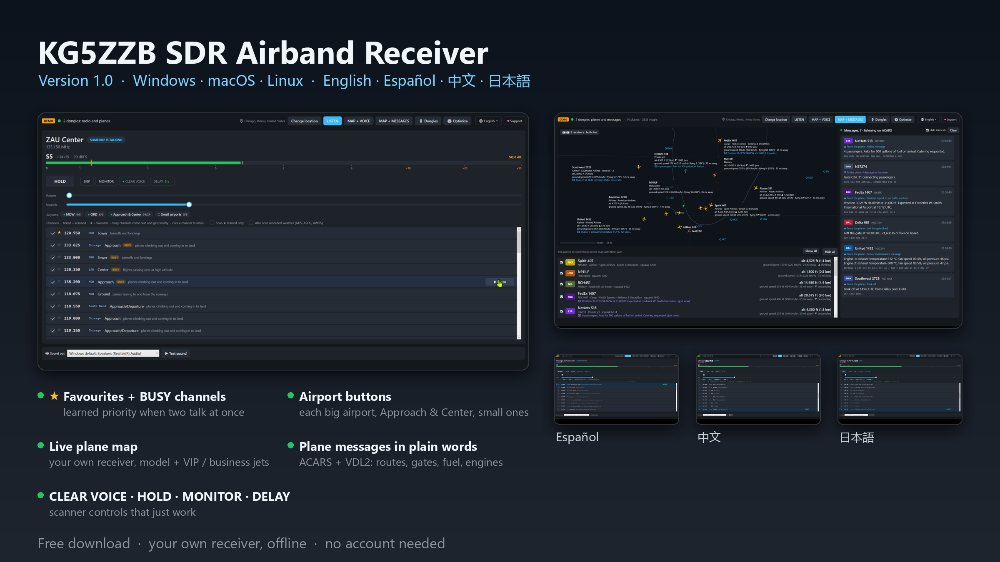
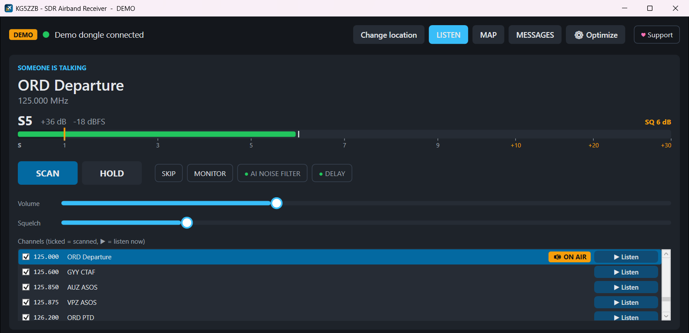
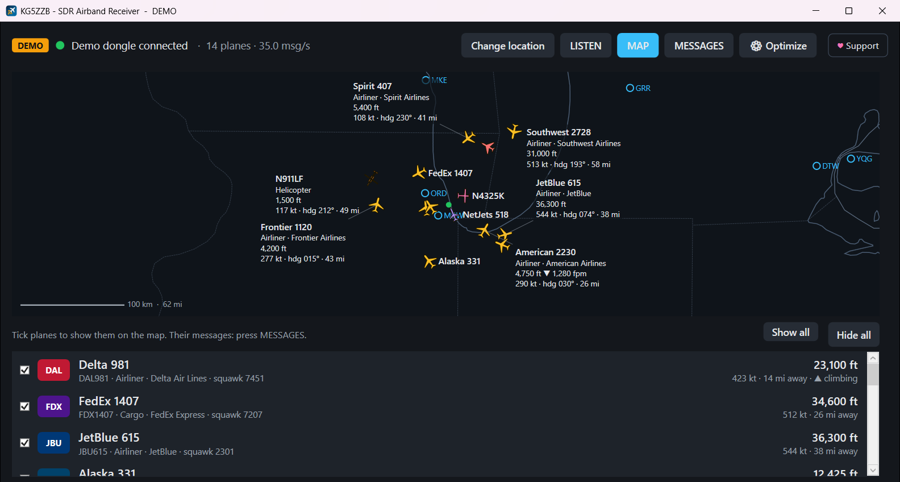
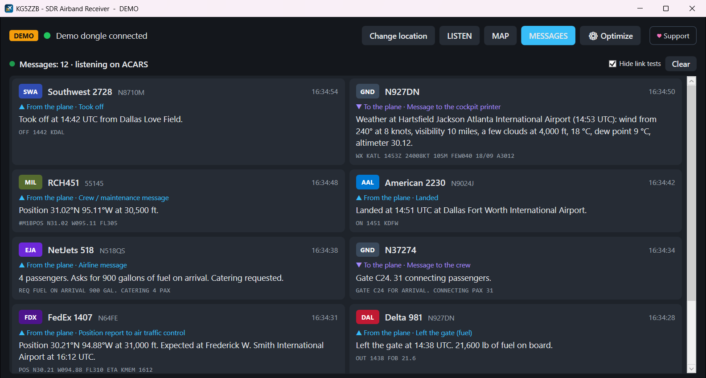
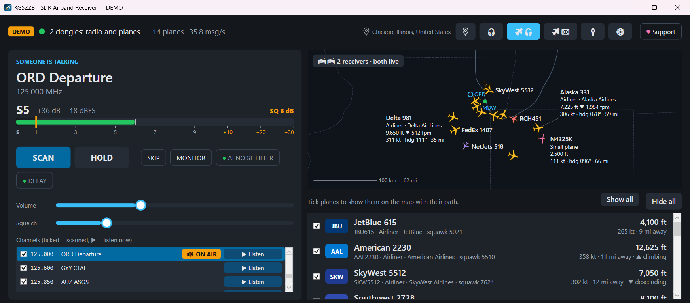
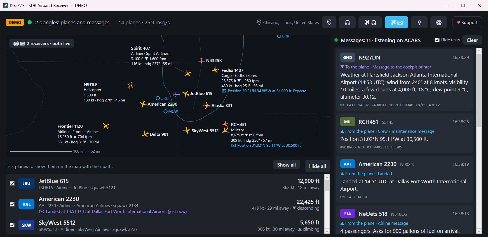
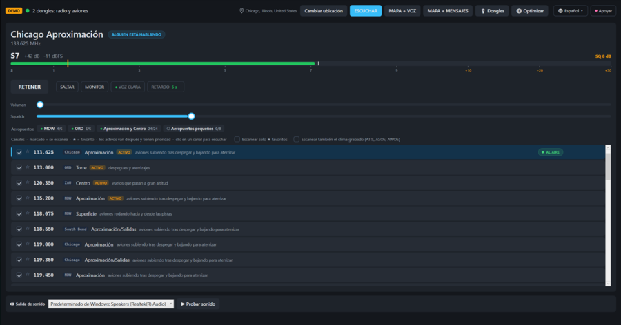
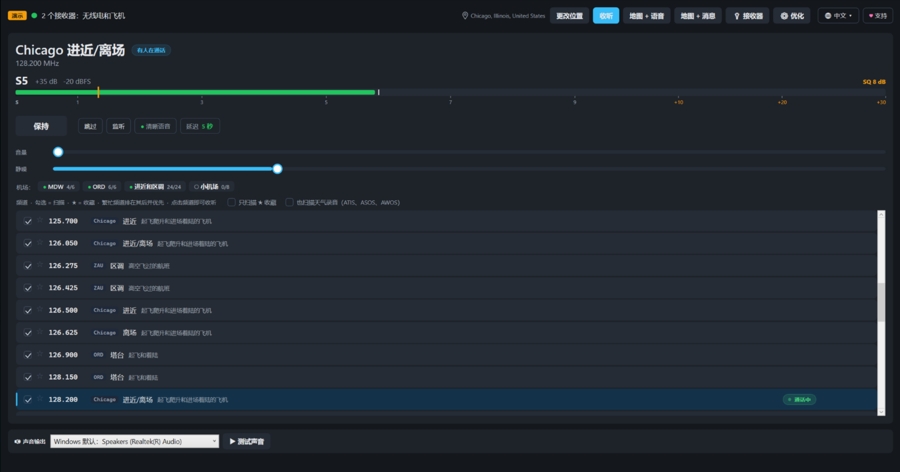
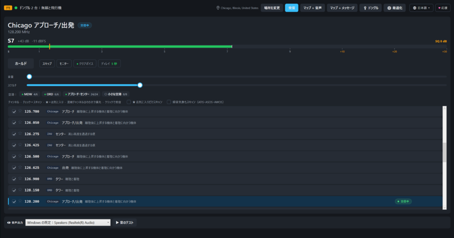

# 📻 KG5ZZB Radio Apps

**Radio receivers for an inexpensive RTL-SDR USB dongle.** 
Hear pilots and air traffic control, see the planes around you on a map and read the messages they send: 
all from your own antenna, offline, in one app.

 

 
  
 
**Free download** · Windows · macOS · Linux · Android phones, tablets & TV · English · Español · 中文 · 日本語 · no install · [release notes](https://github.com/jeypnet/KG5ZZB-Radio-Apps/releases/tag/airband-v1.0.6)

✅ **Works with RTL-SDR Blog V2, V3 and V4, Nooelec NESDR** and every RTL-SDR with an R820T, R820T2, R828D or R860 tuner · [all receivers](#-compatible-receivers)

---

## ✈ KG5ZZB SDR Airband Receiver

Three big buttons, three things to do:

| 🎧 **LISTEN** | ✈ **MAP** | ✉ **MESSAGES** |
|:---:|:---:|:---:|
|  |  |  |
| A scanner for pilots and air traffic control. The channels of the airports within 50 miles are found for you. | Every plane around you with its flight, airline, altitude and speed, on an offline map. | The text messages planes send, each explained in one simple sentence. |

### What you get

| You want to… | Usually that means… | With the Airband Receiver |
|---|---|---|
| **Hear the airband** | Looking up frequencies and typing them into a scanner program | **Channels found for you**, worldwide (about 11,000 airports in 236 countries built in) |
| **Understand quiet pilots** | Turning the volume up and the hiss with it | **🎙 CLEAR VOICE**, one button: [louder, crisper voices with less hiss](#-clear-voice) |
| **See the planes** | A separate decoder program plus a map website | **Built in**: the app's own decoder and an offline map |
| **Read plane messages** | More decoder programs that print raw codes | **Built in**, ACARS and VDL2, **in plain English** |
| **Use your dongle** | A free driver plus a separate USB setup tool | **Our own driver**: [a scanner almost twice as fast](#-measured-our-own-rtl-sdr-driver), and a **one-click USB setup** |
| **Use two receivers** | Deciding which one does what | **Plug and play**: the app finds which receiver hears planes and gives it the map |

### ⚡ Measured: our own RTL-SDR driver

The app talks to your dongle with **its own driver**, written for scanning, instead of the standard free driver most RTL-SDR programs share. Same dongle, same PC:

| | Standard free driver | ✅ **Our driver** |
|---|:---:|:---:|
| ⚡ **Scanner**: one round over 49 channels | 0.7 s | **0.4 s, almost twice as fast** |
| 🔁 **Channel switch** | repeats every tuner setting | **only what changed: 26 ms** |
| 🧹 **Leftover sound from the last channel** | 38 ms | **none** |
| 🛡 **Channel and volume changes without an error** | — | **1000 in a row** |
| 🔗 **How the signal reaches the app** | through a helper program | **directly** |
| 🪶 **Programs running · memory** | 3 · about 200 MB | **1 · about 170 MB** |

Works with the **RTL-SDR Blog V2, V3 and V4** (with the V4's own tuner setup built in), **Nooelec NESDR** and every dongle with an R820T, R820T2, R828D or R860 tuner.

**[→ See the full comparison and how it works](docs/airband-driver.md)**

### 🎙 CLEAR VOICE

One button makes pilots easier to understand. It was tuned by ear on real pilot recordings:

- 🔊 **Louder:** quiet pilots come up to the same loudness as the tower, and soft words come up close to loud ones.
- ✨ **Crisper:** the consonants in call signs and numbers stand out.
- 🌫 **Less hiss:** the hiss is turned down gently, without the robotic sound strong noise removal leaves behind.
- 🛡 **Never crackles:** a limiter keeps loud voices clean, and an empty channel's hiss is never turned up.

### Two receivers? See and hear at once

| ✈🎧 **MAP + VOICE** | ✈✉ **MAP + MESSAGES** |
|:---:|:---:|
|  |  |
| The scanner on the left, the planes on the right. | The planes and their messages, both live. |

### New in 1.0
- **🌐 Four languages:** English, Español, 中文 and 日本語. The app picks your computer's language; switch any time with the 🌐 button.

  | Español | 中文 | 日本語 |
  |:---:|:---:|:---:|
  |  |  |  |
- **★ Favourites and BUSY channels:** the app learns which channels talk the most, keeps them right after your favourites and gives them priority when two talk at once.
- **Airport buttons:** scan or skip a whole airport, Approach & Center, or the small airports (off by default) in one click.
- **Complete US channel lists** from FAA data, "Scan ★ starred + BUSY only", optional recorded weather, and a list that never jumps while you use it.
- **Your exact spot:** your town, coordinates from Google Maps, or your grid locator.
- **macOS and Linux** get everything the Windows app has.

### Everything else
- **📻 A real scanner, made simple:** SCAN, HOLD, SKIP, MONITOR and DELAY work like a handheld scanner.
- **✈ Planes your way:** airline badges, a colour and an icon for each kind of aircraft (airliner, private jet, small plane, helicopter, military), radar-style labels, dotted paths for the planes you follow.
- **🕒 Nothing gets lost:** planes and messages stay for 30 minutes when you switch screens.
- **⚙ Optimize:** tests every gain setting with your antenna and keeps the best one.
- **📻 RTL-SDR, SDRplay and Airspy:** RTL-SDR dongles with R820T/R820T2/R828D/R860 tuners, plus SDRplay RSP1A/1B/2/duo/dx and Airspy R2/Mini (beta).

### ⬇ Downloads for every system

| System | Version | Download |
|---|---|---|
| 🪟 **Windows 10 / 11** (64-bit) | **1.0.6** · free | **[KG5ZZB-SDR-Airband-Receiver-1.0.6-windows-x64.zip](https://github.com/jeypnet/KG5ZZB-Radio-Apps/releases/download/airband-v1.0.6/KG5ZZB-SDR-Airband-Receiver-1.0.6-windows-x64.zip)** |
| 🍎 **macOS** 12+, Apple silicon (M1–M4) | **1.0.6** · free | **[KG5ZZB-SDR-Airband-Receiver-1.0.6-macos-arm64.zip](https://github.com/jeypnet/KG5ZZB-Radio-Apps/releases/download/airband-v1.0.6/KG5ZZB-SDR-Airband-Receiver-1.0.6-macos-arm64.zip)** |
| 🍎 **macOS** 12+, Intel | **1.0.6** · free | **[KG5ZZB-SDR-Airband-Receiver-1.0.6-macos-x64.zip](https://github.com/jeypnet/KG5ZZB-Radio-Apps/releases/download/airband-v1.0.6/KG5ZZB-SDR-Airband-Receiver-1.0.6-macos-x64.zip)** |
| 🐧 **Linux** 64-bit, with a desktop | **1.0.6** · free | **[KG5ZZB-SDR-Airband-Receiver-1.0.6-linux-x64.tar.gz](https://github.com/jeypnet/KG5ZZB-Radio-Apps/releases/download/airband-v1.0.6/KG5ZZB-SDR-Airband-Receiver-1.0.6-linux-x64.tar.gz)** |
| 📱📺 **Android** 8.0+: phone, tablet or Android TV, with USB | **1.0.6** · free | **[KG5ZZB-Airband-Android-1.0.6.apk](https://github.com/jeypnet/KG5ZZB-Radio-Apps/releases/download/airband-android-v1.0.6/KG5ZZB-Airband-Android-1.0.6.apk)** |

- **Windows:** unzip the whole folder and run `KG5ZZB-SDR-Airband-Receiver.exe`. A brand-new dongle: press **🔧 Set up dongle** once. If Windows says "Windows protected your PC", click **More info → Run anyway**.
- **Mac:** move the app to Applications and open it. The app is signed and notarized by Apple; macOS asks once to confirm it was downloaded from the internet: click **Open**.
- **Linux:** copy the included udev rule once so your user can open the dongle; steps in `README-LINUX.txt` inside the archive.
- **Android:** one app for phones, tablets (sideways layout) and Android TV / Google TV. Needs an RTL-SDR with an R820T, R820T2, R828D or R860 tuner and a USB OTG adapter; SDRplay and Airspy work on the desktop versions only. Every feature for the first 30 days; after that Listen and the plane map stay free. No internet permission: the app collects nothing. Install steps below.
- **Free download.** The scanner and the plane map are free, for good. For the first 30 days every extra is switched on too; after that, CLEAR VOICE, HOLD, MONITOR, DELAY and plane messages are an optional upgrade inside the app.

#### 📱 Installing on Android (about one minute, only the first time)
Apps downloaded from a website instead of the Google Play Store need a few extra taps. This is Android's normal safety step for every such app.

1. On the phone or tablet, tap **[KG5ZZB-Airband-Android-1.0.6.apk](https://github.com/jeypnet/KG5ZZB-Radio-Apps/releases/download/airband-android-v1.0.6/KG5ZZB-Airband-Android-1.0.6.apk)**. If the browser warns that the file might be harmful, tap **Download anyway**.
2. When the download finishes, tap it (in the notification, or open **Files → Downloads** and tap the file).
3. Android says your browser isn't allowed to install apps. Tap **Settings**, switch on **Allow from this source**, then tap the back arrow and tap **Install**.
4. Google Play Protect may ask to scan the app. Tap **Scan app** and wait a few seconds (or tap **More details → Install anyway**). Then tap **Open**.
5. In the app, tap **Use my location** (or **Search for a city**).
6. Plug in the dongle with the USB OTG adapter. When Android asks whether **KG5ZZB Airband** may use the USB device, tap **OK**.

Updating later: tap the new `.apk` and **Install**; steps 3 and 4 are usually not needed again and your settings stay.
**Android TV / Google TV:** install a downloader app from the TV's app store (or copy the `.apk` to a USB stick), open the `.apk` with it, allow that app to install unknown apps when the TV asks, then start **KG5ZZB Airband** from the home screen and plug the dongle into the TV's USB port.

All versions: [Releases](https://github.com/jeypnet/KG5ZZB-Radio-Apps/releases).

### 📻 Compatible receivers

| Receiver | Models | Notes |
|---|---|---|
| **RTL-SDR dongles** with an R820T, R820T2, R828D or R860 tuner | Nooelec NESDR SMArt v4 / v5, NESDR Mini 2+, NESDR Nano 2+ / 3 · RTL-SDR Blog V2, V3 and V4 · other RTL2832U sticks with these tuners | Our own driver from 0.8.0. One-click USB setup on Windows. |
| **SDRplay** | RSP1, RSP1A, RSP1B, RSP2, RSP2pro, RSPduo (both tuners at once), RSPdx, RSPdx-R2 | **BETA**, from 0.7.0. Install the free SDRplay API from [sdrplay.com](https://www.sdrplay.com/api/) first (SDRuno users already have it). |
| **Airspy** | Airspy R2, Airspy Mini | **BETA**, from 0.7.0. |
| Not supported | Very old RTL-SDR sticks with an E4000, FC0012, FC0013 or FC2580 tuner (for example the NESDR XTR) | |

**Antennas:** a simple dipole or whip for the airband (118–137 MHz) and a 1090 MHz antenna for planes. With two receivers, give each one its own antenna; the app finds which is which.

---

## 📻 KG5ZZB Shortwave Receiver (coming soon)

**Worldwide shortwave (HF, 2–26 MHz) with the same dongle**: broadcasts from around the world, weather charts, ship warnings, time stations and the famous spy and mystery stations. Pick your country once; everything else is automatic.

### 🎙 VOICE: broadcasts that are on the air *now*
- A built-in **worldwide schedule** (about 7,900 shortwave broadcasts) plus the **DRM** digital schedule. The scanner only visits what is on the air at this minute, on bands that are open at this hour where you are; no time is wasted on empty frequencies.
- Broadcasts aimed at your part of the world come first; the big international stations are listed wherever they can be heard.
- **SCAN on/off**, ◀◀ ▶▶, MONITOR, squelch, and a stay time per station. It learns what you actually hear at your location.

### 🔇 Noise filters: clear audio from a noisy band
Shortwave is full of hiss, whistles, buzz and clicks, and a desktop PC next to the antenna adds its own. The receiver attacks each of them separately, **on your PC, offline, in real time**:

| Filter | What it removes | How |
|---|---|---|
| **Voice only (AI)** | The background hiss, almost completely | A neural network trained to keep speech (DeepFilterNet3), running inside the app with automatic level make-up. Hiss down more than 20 dB with the voice kept. |
| **Clear voice** | Hiss between and under the words, while keeping music | MMSE log-spectral-amplitude estimation with minimum-statistics noise tracking, the classic method of professional radio software. |
| **Whistle & buzz killer** | Heterodyne whistles and the 60/120 Hz buzz of power supplies, with its harmonics | Finds tones that never change and cuts them 30 dB, with 23 Hz precision so music between the buzz harmonics stays. |
| **Noise blanker** | Clicks and crackle from computers, USB cables, LED drivers, dimmers and chargers | Blanks microsecond spikes in the raw radio signal before they can turn into clicks. |
| **Interference map** | Fixed carriers from nearby electronics that look like stations | Learns carriers that carry no programme where nothing is scheduled, remembers them, and the scanner skips them. |
| **Synchronous AM** | Fading distortion, and a whistle or neighbour station on one side of the signal | Locks onto the station's carrier and, when one sideband has interference, listens to the other, cleaner one. |
| **Smooth switching** | The burst of noise when changing station | A short settle time and a soft fade-in on every change. |

### 📟 DATA: decoded on screen
- **Weather fax:** weather maps drawn line by line, lined up automatically, saved as pictures.
- **RTTY** weather text and **NAVTEX** ship warnings, with error correction.
- **🕒 Time stations** and **🕵 spy and mystery stations** (number stations, The Buzzer, The Squeaky Wheel…) to listen to.
- **FIND** tunes to the station coming in best right now; ▶▶ goes to the next one.

---

## 🔌 Hardware
- **Airband Receiver:** see [Compatible receivers](#-compatible-receivers).
- **Shortwave Receiver:** an RTL-SDR dongle with an R820T/R820T2 tuner and a long wire antenna.

## 💬 Help
Found a problem or have a question? Use the **[support form](https://kg5zzb.jeyp.net/support)**: you can attach a recording or screenshot, and it stays private. New versions by email: **[sign up here](https://kg5zzb.jeyp.net/updates?from=github)**.

Into ham radio, RF, SDR or aviation? **[Let's connect on LinkedIn](https://www.linkedin.com/in/jeypnet/)**. I share new radio apps, RF projects and what I learn along the way.

## ♥ Support
The apps are free to use. If you enjoy them, you can support them on **[Ko-fi](https://ko-fi.com/kg5zzb)**.

## 📄 License
The apps are free to download and use. The source code is not public. See [LICENSE.txt](LICENSE.txt) and [THIRD-PARTY-NOTICES.md](THIRD-PARTY-NOTICES.md) for the open-source components they include.

*73 de KG5ZZB*
